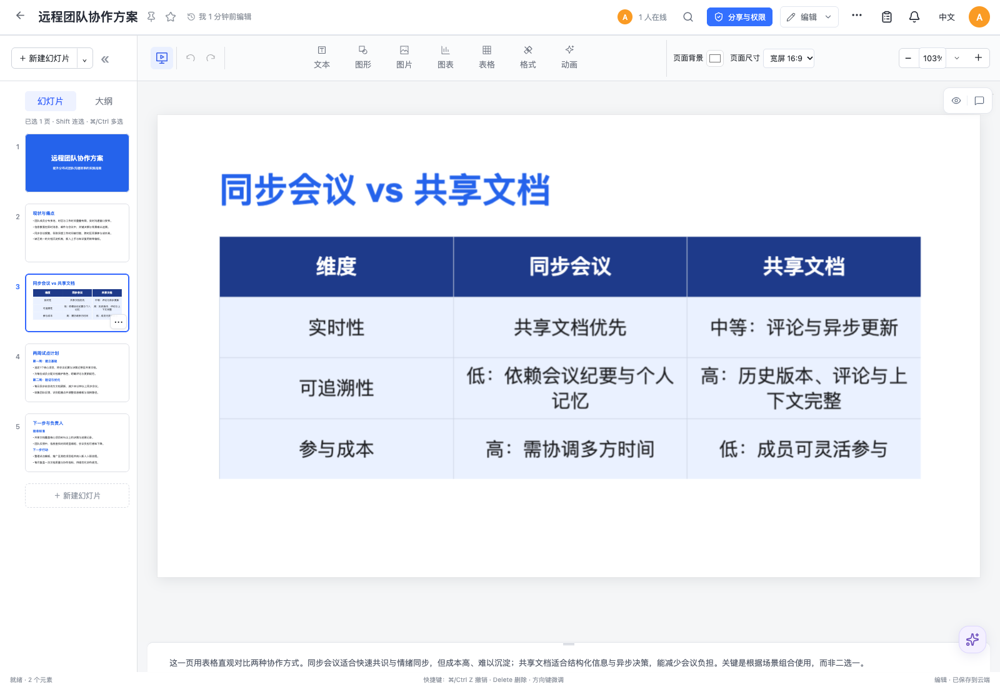
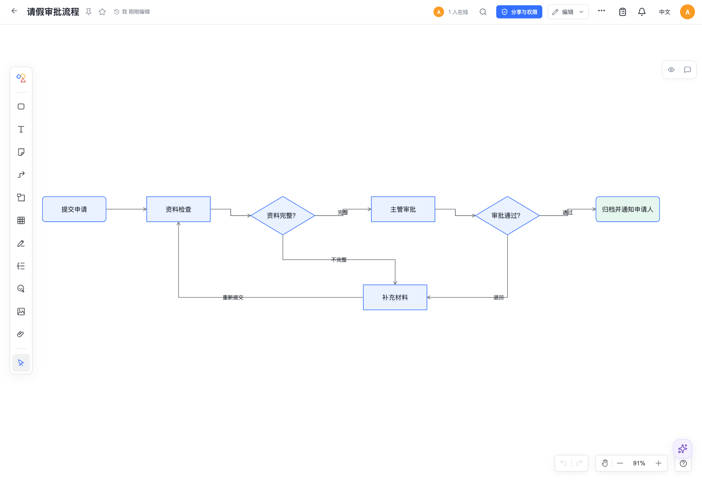
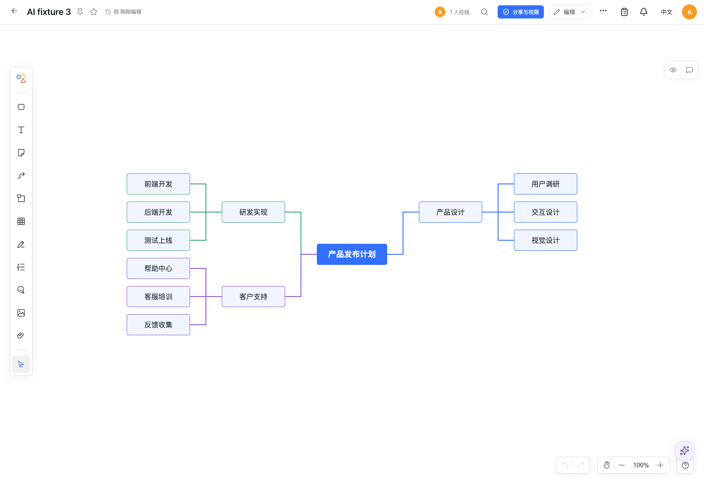
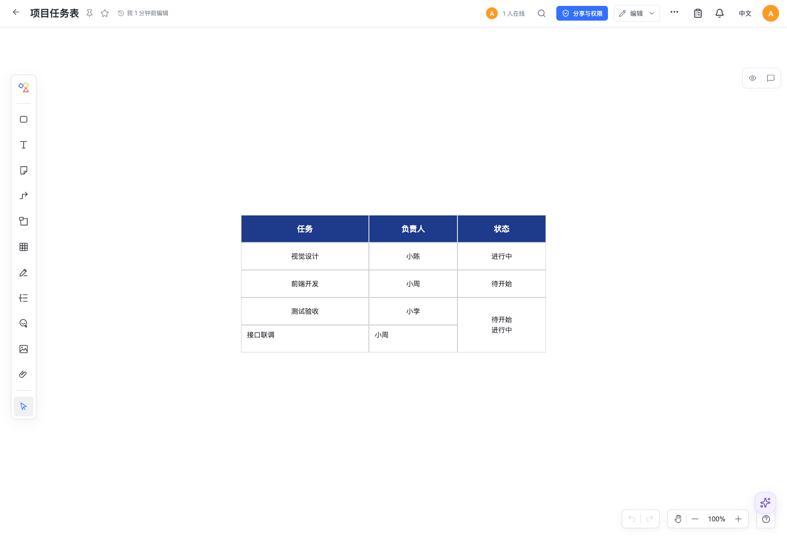
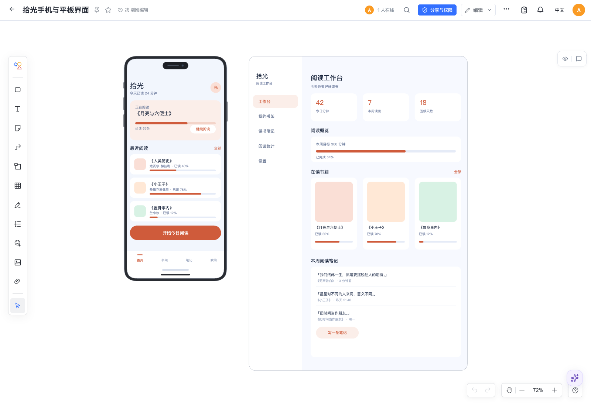
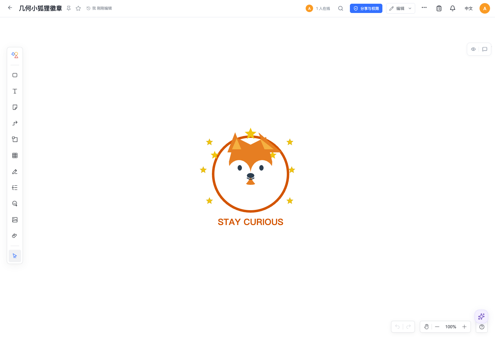

# AI 原生 PPT / 画布验收（2026-10-17）

本次更新工具执行层、读取能力、公开给模型的参数 schema 和内置 skill，清理用户已同意删除的旧参数/元素/单位猜测代码。使用用户指定的模型网关，最终七类场景由 Kimi K2.7 Code 与 DeepSeek V4.1 Flash 完成，另实测 Doubao Seed 2.1 Pro 的图案生成；所有文档、账号、数据库和文件存储均隔离，没有修改用户文档或部署。

## 场景与证据

每个场景均由真实模型调用真实 Doca 工具，保存后由独立 AI 回读验收，再做精确原生数据断言及浏览器截图复核。最终接受 14 个生成/修改任务；模型或脚本的结构通过不替代人工截图复核。

| 场景 | 已核对内容 | 结果 |
| --- | --- | --- |
| 完整 5 页 PPT | 标题、正文、备注、原生对比表格、恰好 5 页；修改指定两页，其他页完全保留；PPTX 导出后重导入 | 通过 |
| 从空聊天新建 PPT | 实际 document_create 建立唯一在线文稿，填充 3 页，再仅修改末页；原页及元素身份保留 | 通过 |
| 画布流程图 | 7 个原生流程节点、条件及退回连线；修改标签和颜色；原生端口、绕行和单套箭头绘制 | 通过 |
| 思维导图 | 原生根主题、四分支及子主题；删指定分支和全部后代、改根标题，其他主题保留 | 通过 |
| 画布表格 | 生成、样式、改格、增行、粘贴、列宽、合并；严格核对新增后最终末两行的状态格合并 | 通过 |
| 手机 / pad UI | phone/tablet 原生容器及可编辑矢量组件；改强调色、按钮文字和笔记标题，原元素 ID 保留 | 通过 |
| 原生矢量图案 | 几何狐狸徽章、原生多边形/路径/星形；修改文字、追加 6 颗星星，原元素 ID 全部保留 | 通过 |

演示文件：[完整 PPT](demo.pptx)。机器结果：[results.json](results.json)。完整模型请求/响应与失败记录保留在本地已忽略的 `artifacts/ai-native-creativity/`，不包含请求头或密钥。

## 多轮测试发现并修复的问题

1. 模板/素材工具的根级 union schema 以及图片工具的 tuple schema 会导致网关拒绝整次请求。现发布对象根和等价数组 schema，原有精确输入与几何验证保留。
2. 画布旧 name 白名单拒绝当前原生对象。已覆盖实际当前分类；通用 primitive 绘图仍可使用。
3. 思维主题的逻辑后代不是场景树子节点。删除现在处理逻辑关系及思维连线，同时保留并断开普通未选中连接器。
4. 模型曾直接增删表格子节点，导致轴元数据与实际单元格不一致。结构修改现强制走表格工作流，失败原子回滚。
5. “存在合并”不足以验收“合并最后两行”。已收紧 demo 断言到最终精确坐标，回执增加最终行列摘要，执行与验收 skill 明确按最终状态计算索引。
6. 流程连接器叠加通用箭头会重复绘制。已使用原生连接器自己的箭头语义，并增加端口、绕行参数。
7. Polygon.points 嵌套点对曾导致图形保存却不可见。已按实际组件声明验证扁平数字/点对象；Path 误用 d 时返回具体未知字段及正确字段名，不自动转换。
8. 图案曾把圆心直接用作原生 x/y，导致五官错位。skill 补充默认左上角坐标、同心圆换算和文字居中尺寸；重新生成与修改后截图复核通过。
9. Kimi 的非流式独立验收曾遇到网关 504。改用当前 SDK 流式接口完整消费输出；只读工具、固定快照和有效验收记录要求保持，真实生成/修改两轮复测通过。

## 自动和浏览器检查

- 22 个相关测试文件、245 项通过；包括原生保存/重载、完整 checkpoint、重复操作、陈旧版本拒绝、权限、错误批次无部分写入、独立单元格并发收敛及无远端回声。
- TypeScript、生产构建、文档检查通过。构建保留既有的包体积和 Vite 配置提示。
- 6 份模型生成投影作为全新隔离资源，在真实 Chrome 中进行了 60 秒空闲、重载、切换阅读模式：零内容更新，内容、seq 和 epoch 不变，无 pageerror。此步骤验证新资源的渲染/重载；原始 CRDT 身份恢复另由宿主自动测试验证。
- 首次 UI 请求达到隔离脚本原先的 180 秒限时、DeepSeek 图案验收达到输出上限、Kimi 非流式验收 504、错误几何及中止的重复失败尝试均保留失败记录，没有将它们计为通过。第 9、13 轮虽然结构检查通过，截图分别发现不可见多边形和错位，因此标记视觉失败；最终图案采用第 14 轮。Doubao 补充轮生成通过，追加修改的长请求在最终 Kimi 两轮完成后主动取消，未计入最终通过任务。

## 画面

## 边界和恢复

没有新增旧格式读取、自动转换或数据库结构变更。旧 canvas/PPT 工具输入猜测已按用户确认删除；富文本和电子表格的既有输入规范化、模型供应商已有协议/摘要探测回退保持原路径，未在本次重构。

Canvas schema 1 保留，PPT v5 继续拒绝，原 checkpoint、epoch、历史和待提交消息不改写。回退保留原部署、依赖和后续写入，旧编辑器不保证理解新功能。未验证生产部署、全部模型组合、Office/WPS 视觉往返或所有输入法。浏览器回放通过原生初始化建立全新测试基线，不代表 JSON 文件导入验收；现有通用导入资源检查会拒绝部分矢量 path，未在本次修改其协议。独立 AI 验收当前只有原生内容读取，截图复核与精确断言仍是必要的独立检查。
