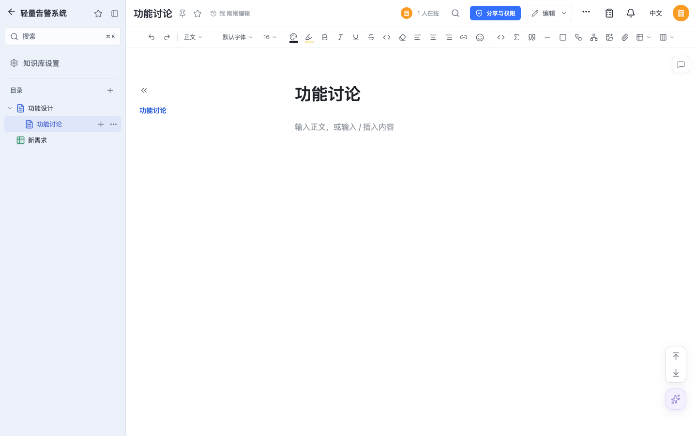
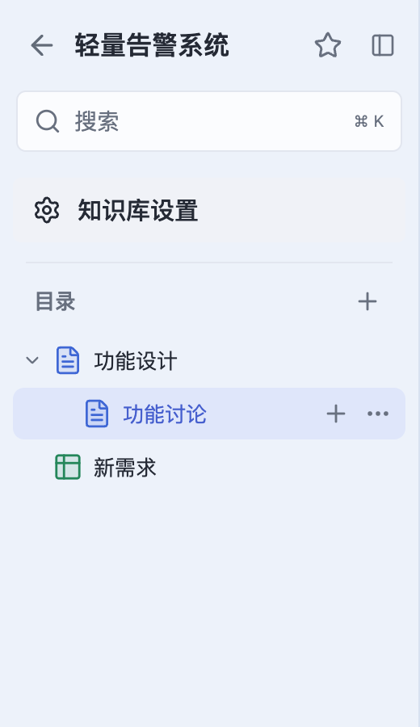

# Editor integration verification — 2026-10-16

Doca 0.1.27: Slate 0.4.15 → 0.4.18, Sheet 0.2.2 → 0.2.3, and visible knowledge-library selection without a vertical marker. All test documents/accounts/databases are synthetic and isolated.

The artifact audit records actual npm tarball integrity, declaration differences and unchanged entrypoints. Schema 3 / schema 6, durable acknowledgements and immutable baselines are retained. The approved native default/display/save behavior and rollback limits are recorded in the [integration contract](../../editor-integration.md#native-editor-upgrade--2026-10-16).

Reproduce with `pnpm exec vitest run tests/editor-package-upgrade.test.ts tests/sheet-package-upgrade.test.ts`, `pnpm exec tsx scripts/qa-editor-package-upgrade.mts`, `pnpm exec tsx scripts/qa-document-tree.mts` and `pnpm exec tsx scripts/verify-editor-package-upgrade.ts sqlite`. The released-image check uses real 0.1.26 to create retained core rows, a native diagram, an 18/72 baseline sheet and a CRDT-appended sheet; current code opens the same database and verifies original rows/baseline/Yjs bytes remain unchanged, old appended display defaults become 19.8/79.2 and fresh documents use those dimensions. PostgreSQL checks require a dedicated `DOCA_TEST_POSTGRES` server and create/drop only a random owned database.

## Results

- 2,883 tests passed; 8 skipped, 280 test files passed. TypeScript and production web build passed.
- PostgreSQL 17 and 18: 199 checks each. Actual released 0.1.26 retained-data opening passed on SQLite and both PostgreSQL versions.
- Host browser: 6 upgrade checks, 29 editor interaction checks, 8 hyperlink checks, including independent 60-second idle windows with zero writes. The selection fix passed 3 consecutive runs of 7 checks, with 100% and 200% screenshots and no vertical marker.
- Actual upstream Slate 0.4.18: 42 focused toolbar/workspace/keyboard/diagram/Yjs tests passed.
- Documentation: 68 bilingual pages checked and built. Six public SDK workspaces are unchanged; npm publication is unnecessary.

See [test summary](test-summary.json), [native host browser](browser.json), [interaction browser](editor-interactions.json), [hyperlink browser](sheet-hyperlink-browser.json), [npm assessment](npm-assessment.json) and [artifact audit](package-audit.json). Initial load-related timeout/retry details are recorded in the summary. Both architecture image smoke/source checks and registry/release checks accompany the final release assets.

