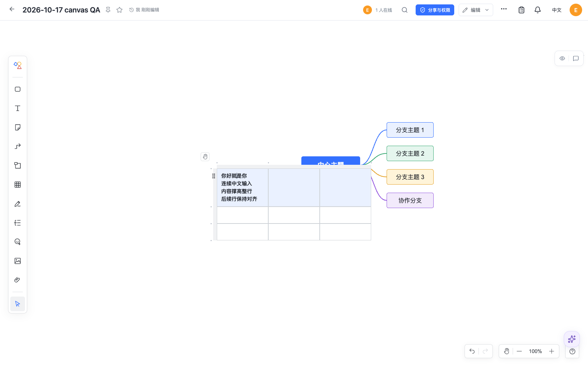
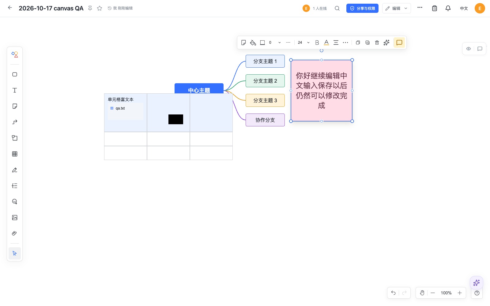

# Doca 0.1.31 release verification

This release integrates the published Canvas 0.5.2, Slate 0.4.22 and Slides alpha.3 packages, the native AI authoring tools/skills and all pending workspace/assistant improvements. It includes the already approved revision-6 presentation rejection policy; no database DDL or new historical reader/conversion is introduced. The earlier 0.1.30 PostgreSQL account policy is retained.

## Source and browser checks

- [Full regression](tests.json): 289 test files, **2,927 passed, 10 environment-dependent tests skipped**, zero failures. The obsolete pixel/flat-text presentation fixture now checks explicit rejection without writes and successful current-format input.
- [Typecheck](typecheck-final.log), [Web build](web-build.log), [documentation check](docs-check.log) and [documentation build](docs-build.log) pass. Existing dependency-deprecation, Vite configuration and bundle-size notices remain.
- [Package audit](canvas-api-audit.json): Canvas public exports/dependencies and declaration signatures match the previously tested 0.5.0 artifact; one internal declaration comment differs. Model runtime bytes match. Temporary tarball references are removed from the runtime/build path.
- [Host/browser checks](browser.json): consecutive Chinese IME input five times, continued editing after save/reload, multiline table growth, text/geometry atomic undo and redo, rich formatting/files, authorized previews and SVG export, native PPT table editing and PPTX reimport, readonly guards and 60 seconds idle without writes. Same-user peers produce no content echo.
- [Workspace checks](workspace.json): source filter, upload/import, all five editor selection references, restored AI drafts and delayed history responses, current administrator online counts. [Chat-history checks](ai-history.json) cover delayed snapshots/errors after image messages.
- [Six AI-generated fixtures](ai-fixture-render.json) reopen under the new packages, remain unchanged through 60 seconds idle/reload/readonly, and send zero content updates. The [earlier real-model demos](../ai-native-tools-2026-10-17/README.md) retain their original dated model results; this replay does not claim a new external-model run or JSON-file import acceptance.

## Candidate images

[arm64](arm64.json) and [amd64](amd64.json) run the actual multi-architecture candidate image with isolated SQLite volumes. Both verify health/version, Host validation, gzip/Brotli assets, bootstrap/login, native package/model loading, new-document creation, restart and clean shutdown as non-root UID 1000. amd64 executes under emulation on the arm64 build machine.

The arm64 check first starts the actual published **0.1.30 image**, creates a user and native Canvas 0.4.3 document, then opens the same volume with 0.1.31. Original saved text, full checkpoint row, epoch and sequence compare exactly. The [smoke script](image-smoke.mjs) only creates/removes its own synthetic containers and volumes.

[Runtime source audit](runtime-audit.json) verifies 419 files per architecture against the source checkout; both architectures have identical source hashes. The [sandboxed Chromium PDF test](renderer.json) runs inside the arm64 image with the checked-in seccomp policy and produces a real PDF. It does not disable Chromium's sandbox.

Image publication digests and GitHub CI/release links are recorded on the GitHub Release after publication. Source builds and image smoke checks do not prove every editor operation, native-device behavior, all Office/WPS layout roundtrips or every deployment kernel's renderer configuration. No user documents or deployment databases were accessed.

## Screenshots

