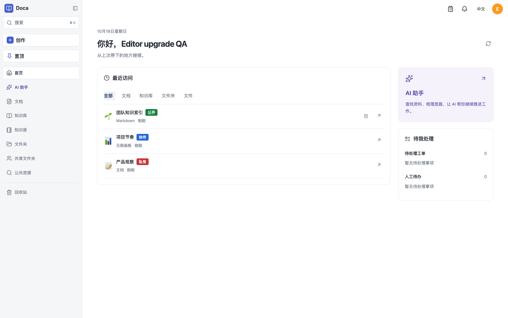
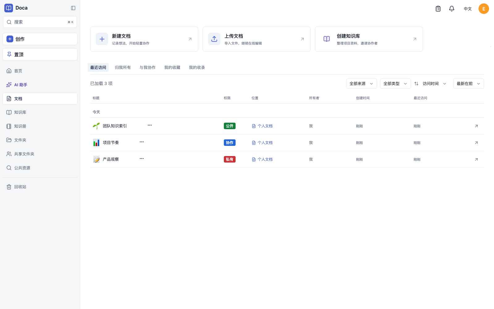
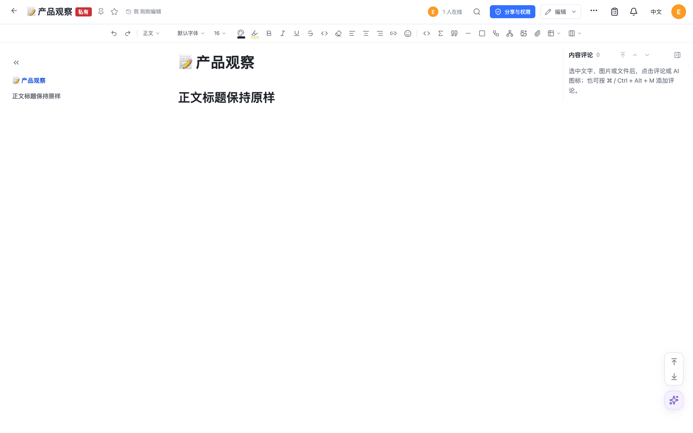
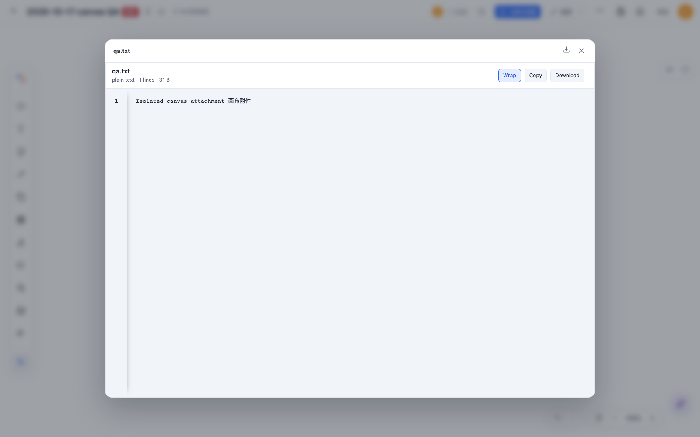

# Doca 0.1.32 verification

All data is synthetic and isolated. This release excludes the original checkout's unrelated pending AI/workspace edits.

- [Package audit](package-audit.json): Slate 0.4.22 → 0.4.23 retains public declarations and byte-identical codec/Yjs/headless/conversion entrypoints. New Leafer dependencies share host-pinned engine 2.1.0. The unchanged DOCX patch applies to 0.4.23. Canvas 0.5.2 → 0.5.3 retains model bytes and adds attachment preview; published npm 0.5.4 adds native inline UI/model metadata while keeping the CanvasModel/codec contract. The installed model matches the registry package hash and final source commit. Host manifest and lockfile contain only the official 0.5.4 registry reference and integrity. Frozen supply-chain verification passes for 2046 entries; a subsequent offline frozen install passes.
- Native Canvas source: lint, TypeScript, example typing and library build pass; 30 model/presence tests and 20 browser scenarios pass. New scenarios cover notes/cards/cells, suggestions, atomic deletion/undo, fragment clipboard, authorized paste, peer convergence, checkpoint reload and late readonly cancellation. Earlier resource/custom-block regressions also pass.
- [Host browser](browser.json): actual installed npm 0.5.4, live server, two browser pages, authorized lookup/paste, durable save, reference index, keyboard undo/redo, rich attachment upload and rendered file preview, reload/readonly, and 60 seconds without content writes. Slate 0.4.23's Leafer workspace opens and cancels without changing the document, and preview refresh after reload does not increment sequence.
- Server regressions cover original released checkpoints, native diagram fields, durable/duplicate ACK, remote replay without echo, invalid mention rejection without partial writes, reference index, checkpoint identity and readonly denial.
- [Resource metadata browser](resource-metadata-browser.json) records three consecutive runs for solid access tags, a separate list column, unchanged rich-text body headings, picker/manual emoji persistence, failed-save draft recovery and responsive headers. The [UI review](ui-review.md) describes the effective zoom viewport and inspected layouts. Derived-permission tests cover inheritance, disabled accounts, custom child permissions and both public scopes across detail, list and home. Grapheme tests cover ZWJ, skin tones, flags, keycaps and titles without a qualifying prefix.

The [multi-architecture build](image-build.json), [arm64](arm64.json) and [amd64](amd64.json) checks use isolated SQLite volumes. Both images verify health/version, Host validation, gzip/Brotli assets, bootstrap/login, native package/model loading, document creation, restart and graceful shutdown as UID 1000. arm64 first starts the actual published 0.1.31 image, writes a native Canvas 0.5.2 document, then upgrades the same volume to 0.1.32; original content, complete checkpoint row, epoch and sequence compare exactly. amd64 runs under emulation.

[Runtime source audits](runtime-arm64.json) ([amd64](runtime-amd64.json)) match all 420 source/manifest files and the official Canvas model hash on both architectures. The [renderer check](renderer.json) generates a real PDF with Chromium's sandbox enabled and the checked-in seccomp policy. [Image smoke](image-smoke.mjs), [runtime audit](runtime-audit.mjs) and [renderer smoke](renderer-smoke.mjs) scripts are reproducible and remove only their own synthetic containers/volumes.

GitHub CI/release links and registry image digests are recorded on the GitHub Release after publication. Browser coverage does not establish all canvas operations, arbitrary concurrent formatting convergence, every native device or Office/WPS layout fidelity.

