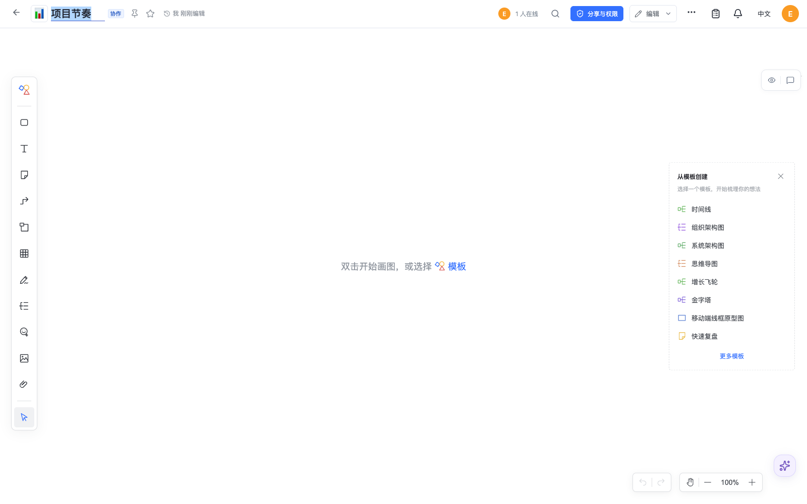
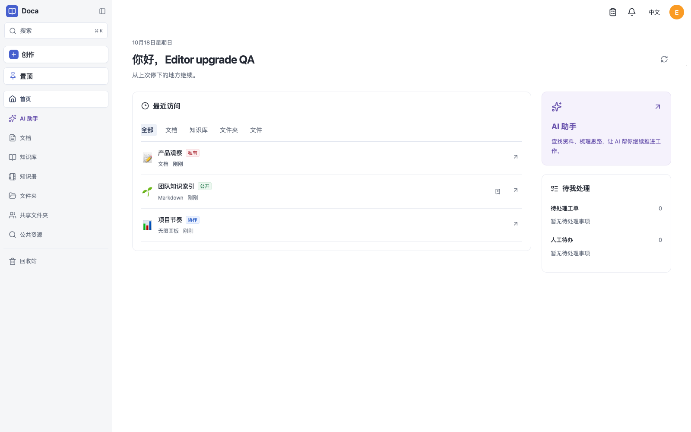
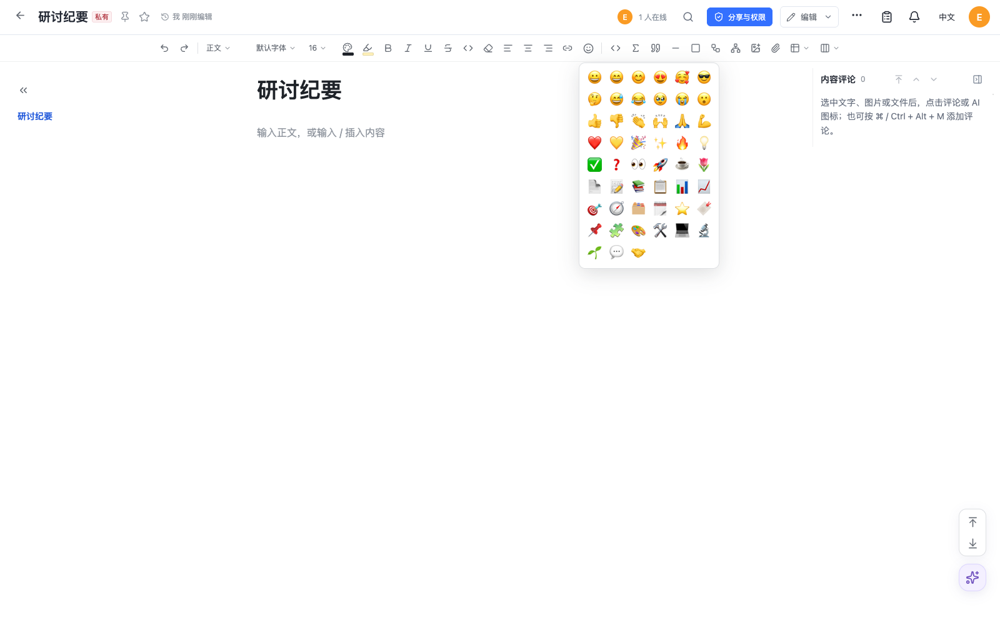
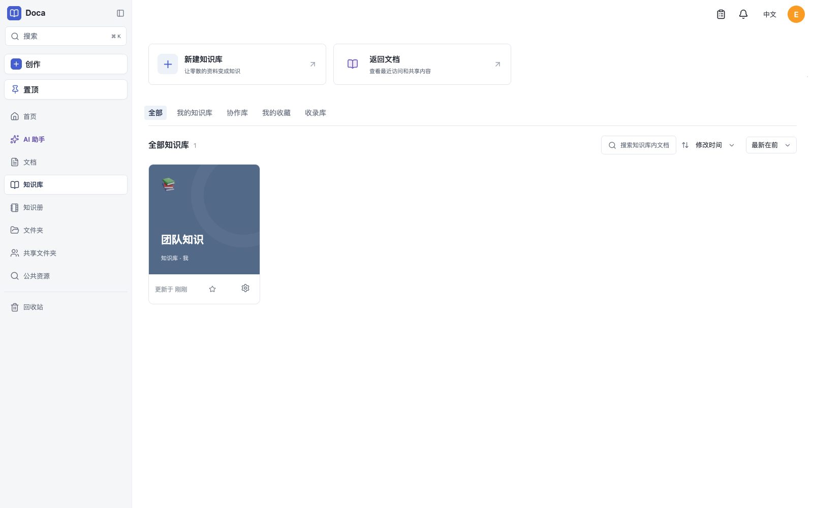

# Doca 0.2.1 verification

This release adjusts host UI and pins official npm Canvas 0.5.5 alongside Slate 0.4.23 and its existing DOCX patch. Canvas removes the code-block menu action and scopes inline/suggestion styles to its root. Public exports, dependencies, declarations and model/codec bytes match 0.5.4; no host API adaptation is necessary. No DDL, stored-title conversion, document migration, backfill, historical adapter or transport change is introduced. All fixtures use synthetic accounts and isolated databases/storage.

Access tags use pale red, blue and green surfaces with darker text. Tags following home-page and document-header titles use 11px text and 16px line height; list tags retain their own column and standard size. The native rich-text title/heading components are untouched. This is a local control adjustment, with no new animation or page redesign.

The title editor separates the existing emoji grapheme/prefix from visible text. Opening and confirming an existing title preserves its exact original string, including extra internal spaces. New empty drafts retain their selected icon; a hidden named input submits the complete title through normal FormData, and the required visible field still requires title text. Native length limits account for the prefix. Manual emoji paste, replace, remove, failed saves and reload are exercised.

The shared emoji list feeds both title selection and the existing host rich-text toolbar. All 24 document icons are present exactly once alongside the original emoji. The toolbar continues using the native text command; no SDK API is added. Browser checks cover actual insertion into a rich-text title, durable reload, peer convergence and absence of remote echo or idle writes.

Three consecutive final UI runs passed against installed npm Canvas 0.5.5; their checks are retained in [the browser record](resource-metadata-browser.json). The [package audit](package-audit.json) verifies npm SHA-512 integrity, all 143 tagged source/build files, byte-identical model/codec and 117 public declarations. [Full regression](tests.json) passed: 2,948 tests in 290 passing files, with 10 environment-dependent tests skipped across three files. Typecheck, Web build and documentation check/build (74 bilingual pages) pass. Final installation and tests run sequentially; earlier package-resolution failures from overlapping installation were corrected without test or timeout changes. Run `node_modules/.bin/tsx scripts/qa-resource-metadata.mts` to reproduce the real host/browser scenario. The 800px view is the effective layout width of a 1600px viewport at 200% zoom; it is not a claim of browser zoom emulation. Local visual review is performed by the main agent.

Library creation and renaming use the same emoji/text control. Library cards replace the original BookOpen glyph only for a qualifying title prefix, and the home activity list also handles libraries with no document format. Removing an emoji restores the original type icon. Browser fixtures exercise creation, replacement, reload and removal through real forms and APIs.

[Visual review](ui-review.md) covers the actual desktop, effective zoom-width and narrow screenshots.

[Canvas integration browser checks](canvas-browser.json) pass against installed npm 0.5.5: host-owned user search, native mention and authorized document paste, durable ACK and reference indexing, atomic undo/redo, rich attachment upload and actual host file preview, readonly/reload, and 60 seconds without content writes. The Slate 0.4.23 Leafer workspace also opens, cancels and refreshes previews without rewriting content.

The [multi-architecture candidate](image-build.json) passes [arm64](arm64.json) and [amd64](amd64.json) checks: health/version, Host validation, gzip/Brotli assets, bootstrap/login, model loading, document creation, restart and graceful shutdown as UID 1000. The arm64 check starts the actual released 0.1.32 image (Canvas 0.5.4), writes a native Canvas document, then upgrades the same isolated volume to 0.2.1. Original content, the complete checkpoint row, epoch and sequence compare exactly. amd64 runs under emulation.

[Runtime audits](runtime-arm64.json) ([amd64](runtime-amd64.json)) match all 420 source/manifest files and the official npm Canvas model hash on each architecture. The [renderer check](renderer.json) produces a real PDF with Chromium's sandbox and the checked-in seccomp policy enabled. Reproduce using [image smoke](image-smoke.mjs), [runtime audit](runtime-audit.mjs) and [renderer smoke](renderer-smoke.mjs); scripts remove only their own synthetic containers and volumes.

Database CI passes on PostgreSQL 17 and 18 on source commit `39d3cf1010ca2132ccf1f643f139431455bf7784`: [workflow](https://github.com/smartdoca/doca/actions/runs/39103601961). [Documentation CI](https://github.com/smartdoca/doca/actions/runs/39103602005) passes. Registry digest, final merge/tag and release workflow are recorded on the GitHub Release after publication. No production/user data is used. These checks do not establish every canvas operation, arbitrary concurrency convergence, all native devices or Office layout fidelity.
