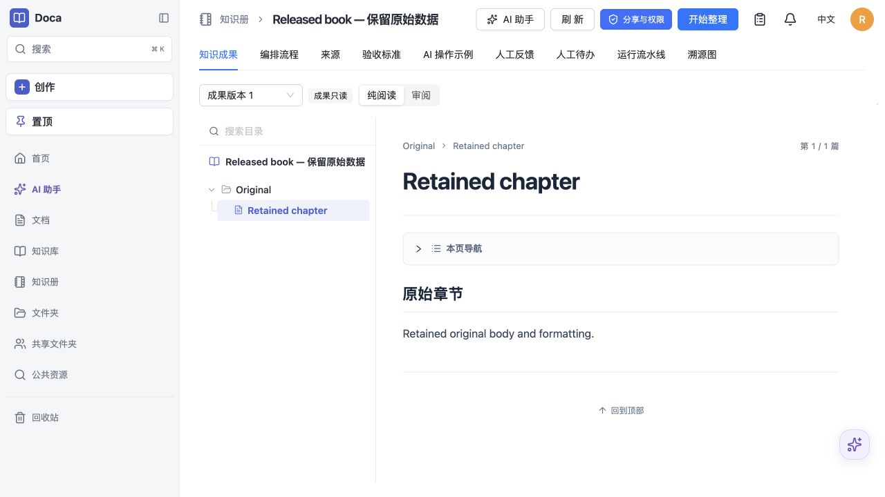

# Doca 0.2.4 verification

Runtime changes, book presentation changes and the approved checkpoint contract are documented in the [release notes](../../releases/0.2.4.md). All tests use isolated databases, synthetic accounts and disposable container volumes; no production site is upgraded by this verification.

The [full suite](tests.json) passes 2,993 tests with the CI two-worker bound; 10 environment-dependent tests remain skipped. The initial unrestricted run overlapped two architecture builds and had five failures, including three tests at their time limits. All 270 tests in the affected files pass a targeted recheck, followed by the successful complete run. Assertions and timeout thresholds are unchanged. TypeScript, both production bundles, documentation check/build for 77 bilingual pages and the image-only deployment archive checksum pass.

The [checkpoint record](../knowledge-book-checkpoints-2026-10-19/README.md) covers SQLite 211 tests, PostgreSQL 17/18 each 98 tests, actual released 0.2.3 data and cold-process recovery. The PostgreSQL CI matrix now explicitly includes both new checkpoint suites.

The first two PostgreSQL 18 CI attempts passed all 236 assertions but reported an idle-pool `57P01` exception while force-dropping a temporary permissions-test database. The test fixture now waits for its own server connections to close after pool shutdown and drops normally, failing explicitly if connections remain. No exception is ignored, no assertion is removed, and production database behavior is unchanged. The two permissions tests pass on both PostgreSQL 17 and 18 after this cleanup correction.

The [accepted multi-architecture image](image-build.json) passes independent [arm64](arm64.json) and [amd64](amd64.json) checks as UID 1000: health/version, original-user login, original book reads, Host rejection, gzip/Brotli assets, restart, graceful stop and cold checkpoint recovery. Each architecture creates a native book fixture using the actual 0.2.3 image, verifies all 13 retained table hashes and byte-exact node/run/release bodies after upgrade, starts the real 0.2.4 service and repeats strict preservation checks before authentication. Normal login then updates `last_login_at`; the published result is compared again after restart. The seeded publication tests storage preservation, not model quality.

In both architecture images, a separate SQLite/file-store fixture commits a complete checkpoint, runs its Node process under `--init` (as production Compose does), then kills that process with SIGKILL. A fresh process restores the first batch with zero producer calls and runs the missing batch once; both references survive GC. This is a separate process and database from the HTTP service.

Runtime audits on [arm64](runtime-arm64.json) and [amd64](runtime-amd64.json) match 426 source/manifest/renderer files and 479 uncompressed built-Web files to this checkout. Editor pins remain unchanged. Accepted image config IDs include the complete filesystem; a final index with refreshed merge provenance must keep these same config IDs. Publication digests and CI links are recorded on the GitHub Release.

The [built-image browser check](browser.json) uses the real production server and a synthetic released book. It verifies the complete sidebar, card, original prose, expandable directory tree and workflow palette/compact graph, with no content/configuration edits or model request. The temporary verification tab, container and volume are cleaned up; the user's existing local preview stays available.



Reproduction from the repository root:

```sh
pnpm exec vitest run --maxWorkers=2
pnpm typecheck
pnpm build
pnpm docs:check
pnpm docs:build
node scripts/pack-deployment.mjs
node docs/verification/release-0.2.4/image-smoke.mjs arm64
node docs/verification/release-0.2.4/image-smoke.mjs amd64
node docs/verification/release-0.2.4/runtime-audit.mjs arm64
node docs/verification/release-0.2.4/runtime-audit.mjs amd64
```

Container checks require a locally built `smartdoca/doca:0.2.4-candidate` multi-architecture image and the released 0.2.3 image. amd64 executes under emulation on this arm64 host. No paid 150,000-character generation or production-duration benchmark was performed. No online database or running production site was modified.
